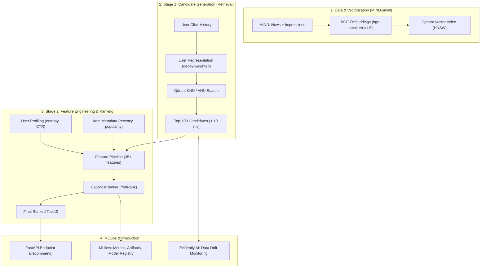

# Two-Stage News Recommender System (MIND Dataset)

[](https://www.python.org/downloads/)
[](https://docs.astral.sh/uv/)
[](https://github.com/astral-sh/ruff)

A production-grade, two-stage news recommendation system built on the **Microsoft News Dataset (MIND)**. The project bridges modern vector search and classic tabular Learning-to-Rank, complete with MLOps tracking, data drift monitoring, and low-latency API serving.

---

## 🏗 System Architecture



---

## 🎯 Key Stages & Capabilities

1. **Candidate Retrieval (Stage 1):**
   - Dense semantic retrieval with `BAAI/bge-small-en-v1.5` (384d).
   - Real-time user interest vector with temporal exponential decay ($\lambda = 0.85$).
   - HNSW indexing in **Qdrant** with Recall@100 evaluation and sub-10ms retrieval.

2. **Feature Engineering & Ranking (Stage 2):**
   - 35+ engineered features: User profile, Item popularity/recency, and Cross-features (lexical overlap, category affinity, cosine similarity).
   - Learning-to-Rank with **CatBoostRanker** (`YetiRank`) grouped by impression.
   - Comprehensive ranking evaluation: **NDCG@5**, **NDCG@10**, **MRR**, **MAP**.

3. **MLOps & Governance:**
   - Experiment tracking, hyperparameter logging, and Model Registry with **MLflow** / **DagsHub**.
   - SHAP summary plots and feature importance analysis.

4. **Data Quality & Drift Detection:**
   - Feature distribution monitoring with **Evidently AI** (Wasserstein distance, Kolmogorov-Smirnov, Jensen-Shannon divergence).
   - Automated HTML drift reports for sliding temporal windows.

5. **Production Serving:**
   - Asynchronous **FastAPI** service (`POST /recommend`).
   - Latency budget: $p95 < 30 \text{ ms}$ on CPU.

---

## 📁 Repository Structure

```
mind-dataset-recsys/
├── .env.example              # Environment variables template
├── pyproject.toml            # Modern project configuration (uv, ruff, pytest)
├── src/
│   └── mind_recsys/
│       ├── __init__.py
│       ├── config.py         # Pydantic Settings & environment variables
│       ├── data/             # MIND dataset loading & pre-processing
│       ├── retrieval/        # Stage 1: Embeddings & Qdrant vector index
│       ├── features/         # Stage 2: 35+ engineered features
│       ├── ranking/          # Stage 2: CatBoostRanker & evaluation metrics
│       ├── monitoring/       # Stage 4: Evidently AI drift monitoring
│       └── service/          # Stage 5: FastAPI microservice
├── notebooks/                # Modular Colab / Jupyter notebooks
│   ├── 01_eda_and_data_prep.ipynb
│   ├── 02_candidate_retrieval_qdrant.ipynb
│   ├── 03_feature_engineering_catboost_mlflow.ipynb
│   └── 04_drift_monitoring_and_export.ipynb
└── tests/                    # Unit & integration tests
```

---

## 🚀 Quickstart

### Prerequisites
- Python >= 3.12
- [uv](https://docs.astral.sh/uv/)

### Installation

```bash
# Clone the repository
git clone https://github.com/TheNarhawl/mind-dataset-recsys.git
cd mind-dataset-recsys

# Install dependencies with uv
uv sync --all-groups

# Configure environment variables
cp .env.example .env
# Edit .env and set your HF_TOKEN and optional MLflow/Qdrant credentials
```

### Running Tests & Quality Checks

```bash
# Run test suite
uv run pytest

# Lint and format checks
uv run ruff check .
uv run ruff format --check .
```

